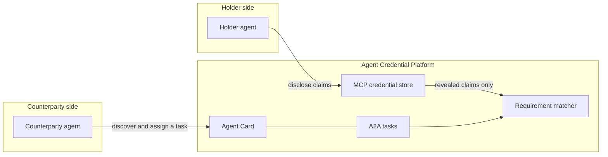

# Agent Credential Platform

A hybrid AI agent platform for privacy-preserving credential verification
and matching.

Holders disclose selected claims from verifiable credentials. A counterparty
describes an opportunity as claim requirements. The matcher ranks candidates
from revealed claims only. It does not know which industry those claims come
from.

This repository is a scaffold. Selective disclosure is a small SD-JWT
implementation signed with a development HMAC key, not an issuer DID key.
Do not gate access to anything real on it.

## Markets

The core stays industry-agnostic. Each market is a rule pack: a JSON file
and an optional module. A pack names accepted credential types, the issuers
trusted for each type, required versus weighted claim requirements, and how
long a disclosure is kept.

Education is the first pack and the launch wedge: match schools, teachers,
and students from claims they are willing to show
([examples/school_match_demo.py](examples/school_match_demo.py),
`acp.verticals.education`, `education.rules.json`).

Enterprise HR and executive screening is a later pack. It would bring its
own file. The matcher, credential store, and protocol adapters stay the same.
Storage is in memory. Every credential and disclosure record carries
`tenant_id` and a rule-pack id so a durable store can enforce per-pack
retention later.

## Protocols

| Channel | Role here | Status |
| --- | --- | --- |
| [MCP](https://modelcontextprotocol.io) | Private context. A holder's agent lists credentials and asks for a disclosure. `read_credential` returns the full credential only with holder proof, and is denied by default. | In-memory store on the official `mcp` Python SDK (`MCPServer`, the 2.x name of the class that 1.x called `FastMCP`). |
| [A2A](https://a2a-protocol.org/latest/specification/) | Collaboration. One matching agent. The Agent Card is the source of truth; tasks are the unit of work. | Agent Card at `/.well-known/agent-card.json` and a JSON-RPC task handler. Tasks carry `tenantId` and `rulePackId`. |
| ANP / DIDs | Long-term discovery. Resolvers cover `did:web`, `did:key`, and ANP `did:wba`. | ANP Agent Description is an unsigned stub derived from the Agent Card. `did:web` and `did:wba` do not fetch the network. |
| DID + VC + selective disclosure | Show a claim without handing over the credential. | SD-JWT is the default scheme. BBS+ and zk-SNARK predicates are documented stubs behind the same interface. Trusted issuers come from the rule pack. |

MCP keeps raw credentials off the agent-to-agent wire. A2A is how a
counterparty finds the matcher and records a task. ANP is the direction for
decentralized identity once the card-and-task flow is not enough. Details
and the spec points that were checked are in [docs/protocols.md](docs/protocols.md).

## Architecture



Issuers sign credentials. Holders choose what to reveal. A verifier checks
the disclosure. Candidates are holders reduced to revealed claims.
Opportunities are configurable requirements. A longer version, including the
ANP seam and the education example, is in
[docs/architecture.md](docs/architecture.md).

Decisions from Nov 2, 2026, and the choices still open, are in
[docs/open-questions.md](docs/open-questions.md). Remaining choices are
marked in code with `# OPEN QUESTION:`.

## Layout

```
src/acp/
  app.py                 FastAPI app
  cli.py                 `acp serve` | `acp mcp` | `acp demo`
  protocols/base.py      adapter interface
  protocols/mcp/         mock credential store (MCP SDK)
  protocols/a2a/         Agent Card and task handler
  protocols/anp/         ANP description derived from the Agent Card
  credentials/           VC models, DID methods, SD-JWT, scheme stubs
  matching/              Candidate, Opportunity, requirement matcher
  rules/                 JSON rule-pack loader
  verticals/education.py first rule pack (schools / teachers / students)
examples/school_match_demo.py
tests/
docs/
```

## Run the demo

Requires Python 3.11 or newer.

```bash
python -m venv .venv
source .venv/bin/activate
pip install -e ".[dev]"
acp demo
```

The demo loads the education rule pack: sample teaching-license and
enrollment credentials, an SD-JWT disclosure checked against the issuers
that pack trusts for each type, then the generic matcher against North
High's requirements. Home addresses, dates of birth, and student numbers
stay in the credentials.

Other entry points:

```bash
acp serve          # http://127.0.0.1:8000/.well-known/agent-card.json
acp mcp            # credential store on stdio, seeded with the education example
acp mcp --transport streamable-http --port 8001
pytest
ruff check .
```

`acp serve` and `acp mcp` are separate processes. The demo calls the library
directly and does not need either one running.

## Development

Runtime dependencies are in `pyproject.toml` and mirrored in
`requirements.txt`. Lint and tests for a checkout:

```bash
pip install -e ".[dev]"
ruff check .
pytest
```

Continuous integration runs that pair on Python 3.11 and 3.12.

## License

[MIT](LICENSE). Copyright (c) 2026 William Johnson.
