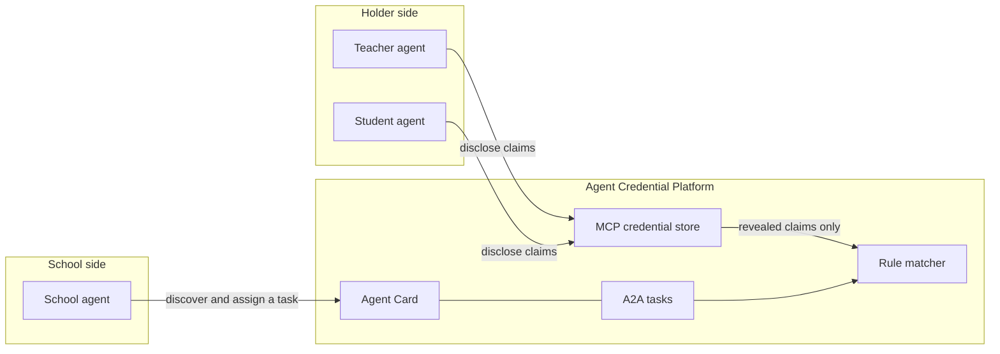

# Agent Credential Platform

A hybrid AI agent platform for privacy-preserving credential verification
and matching.

The first market is schools, teachers, and students: a school needs a
licensed teacher for a subject and grade band, and students need a program
that fits the grade and interests they are willing to disclose. Enterprise
HR and executive screening is a later market. It can reuse the protocol
adapters, but not the school matching rules, until someone writes that
policy down.

This repository is a scaffold. The selective-disclosure code is a sketch
with the shape of a real presentation, not a proof. Do not gate access to
anything real on it.

## Protocols

| Channel | Role here | Status |
| --- | --- | --- |
| [MCP](https://modelcontextprotocol.io) | Private context. A holder's agent reads a credential store and asks for a disclosure. | Mock store on the official `mcp` Python SDK (`MCPServer`, the 2.x name of the class that 1.x called `FastMCP`). |
| [A2A](https://a2a-protocol.org/latest/specification/) | Collaboration. Agent Cards for discovery, Tasks for a unit of work. | Agent Card at `/.well-known/agent-card.json` and a JSON-RPC task handler. |
| ANP / DIDs | Long-term discovery on an open network, with DIDs as agent identity. | Adapter seam only. Both A2A and ANP are meant to sit behind the same interface. |
| DID + VC + selective disclosure | Show a claim without handing over the credential. | Pydantic VC models, a DID resolver interface, and notes on BBS+, SD-JWT, and zk-SNARK/circom. |

MCP keeps raw credentials off the agent-to-agent wire. A2A is how a school
agent finds the matcher and records a task. ANP is the direction for
decentralized identity once the card-and-task flow is not enough. Details
and the spec points that were checked are in [docs/protocols.md](docs/protocols.md).

## Architecture



A longer version, including the ANP seam, is in [docs/architecture.md](docs/architecture.md).
Choices that need a person are marked in code with `# OPEN QUESTION:` and
listed in [docs/open-questions.md](docs/open-questions.md).

## Layout

```
src/acp/
  app.py                 FastAPI app
  cli.py                 `acp serve` | `acp mcp` | `acp demo`
  protocols/base.py      adapter interface
  protocols/mcp/         mock credential store (MCP SDK)
  protocols/a2a/         Agent Card and task handler
  protocols/anp/         DID projection stub
  credentials/           VC models, DID resolver, disclosure sketch
  matching/              Teacher, School, Student profiles and matcher
examples/school_match_demo.py
tests/
docs/
```

## Run the demo

Requires Python 3.11 or newer.

```bash
python -m venv .venv
source .venv/bin/activate
pip install -e ".[dev]"
acp demo
```

The demo issues sample teaching-license and enrollment credentials, discloses
a subset of the claims, ranks teachers and students for North High, and
stores the summary as a completed A2A task. Home addresses, dates of birth,
and student numbers stay in the credentials.

Other entry points:

```bash
acp serve          # http://127.0.0.1:8000/.well-known/agent-card.json
acp mcp            # credential store on stdio, for an MCP host
acp mcp --transport streamable-http --port 8001
pytest
ruff check .
```

`acp serve` and `acp mcp` are separate processes. The demo calls the library
directly and does not need either one running.

## Development

Runtime dependencies are in `pyproject.toml` and mirrored in
`requirements.txt`. Lint and tests for a checkout:

```bash
pip install -e ".[dev]"
ruff check .
pytest
```

Continuous integration runs that pair on Python 3.11 and 3.12.

## License

[MIT](LICENSE). Copyright (c) 2026 William Johnson.
