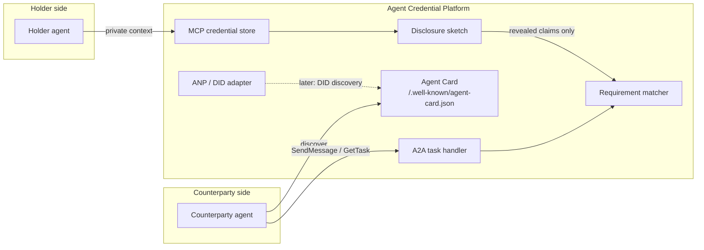

# Architecture

The platform is a thin coordination layer. It does not run a model, and it
does not implement a production credential stack. Three protocol adapters sit
in front of two pieces of domain logic: selective disclosure and matching.
Neither piece is tied to an industry.

## Roles

* **Issuer** signs a credential. On the wire that is `VerifiableCredential.issuer`, a DID.
* **Holder** is the credential subject. The holder chooses which claims to reveal.
* **Verifier** checks a disclosure against trusted issuers. The sketch in `src/acp/credentials/zkp.py` checks shape and issuer allow-list only.
* **Candidate** is a holder reduced to revealed claims (`src/acp/matching/profiles.py`).
* **Opportunity** is the counterparty's ask: a list of claim requirements. The matcher drops a candidate when a required check fails and scores the rest by weight.

A market supplies credential types, the claims it reveals, and the requirements on an opportunity. It does not get its own matcher.

## What talks to what

* **MCP** is the private-context channel. A holder's agent lists credentials and asks for a disclosure. The full credential stays in the store. See `src/acp/protocols/mcp/`.
* **A2A** is the collaboration channel. The matching agent publishes an Agent Card and accepts tasks. Counterparties do not get a handle to the credential store. See `src/acp/protocols/a2a/`.
* **ANP / DIDs** are the long-term discovery direction. `ANPAdapter` only records the seam: a DID would project onto an Agent Card. See `src/acp/protocols/anp/`.
* **Credentials** are pydantic VC-shaped documents, a `DIDResolver` interface, and a mock prover/verifier. See `src/acp/credentials/`.
* **Matching** applies configurable claim requirements. See `src/acp/matching/`.

## Flow

1. An issuer writes a credential into the holder's store.
2. The holder's agent builds a disclosure of the claims the counterparty is allowed to see. A verifier checks the issuer.
3. The market maps those revealed claims onto a `Candidate`.
4. The counterparty's `Opportunity` lists the requirements. The matcher applies them.
5. The outcome is recorded as an A2A task artifact. Withheld claims are not copied into that artifact.

The HTTP app (`src/acp/app.py`) serves the card and the task endpoint. The MCP server is a separate process (`acp mcp`) because MCP hosts launch servers themselves, usually over stdio. They share code, not a live object, in this scaffold.

## Education example

`src/acp/verticals/education.py` and `examples/school_match_demo.py` are the launch wedge, not the core. A state board and a school are issuers. Teachers and students are holders. North High is the counterparty. The vertical derives `grade_band` and `placement` from revealed claims, then calls `match_candidates`. `acp demo` runs that example. The MCP server's default store is seeded with the same sample so the placeholder has data; swap the store for another market.

## Processes

| Command | Process | Speaks |
| --- | --- | --- |
| `acp serve` | FastAPI via uvicorn | A2A Agent Card and JSON-RPC tasks |
| `acp mcp` | MCP server | Credential store tools |
| `acp demo` | One-shot script | Education example; no sockets |

Open choices are marked in code with `# OPEN QUESTION:` and collected in
[open-questions.md](open-questions.md).
