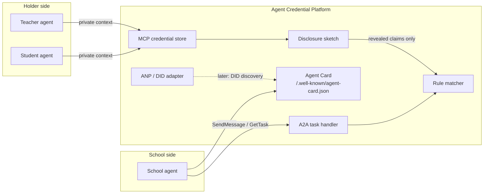

# Architecture

The platform is a thin coordination layer. It does not run a model, and it
does not implement a production credential stack. Three protocol adapters sit
in front of two pieces of domain logic: selective disclosure and matching.

## What talks to what

* **MCP** is the private-context channel. A holder's agent lists credentials
  and asks for a disclosure. The full credential stays in the store. See
  `src/acp/protocols/mcp/`.
* **A2A** is the collaboration channel between organizations. The matching
  agent publishes an Agent Card and accepts tasks. Counterparties do not get
  a handle to the credential store. See `src/acp/protocols/a2a/`.
* **ANP / DIDs** are the long-term discovery direction. `ANPAdapter` only
  records the seam: a DID would project onto an Agent Card. See
  `src/acp/protocols/anp/`.
* **Credentials** are pydantic VC-shaped documents, a `DIDResolver`
  interface, and a mock prover/verifier. See `src/acp/credentials/`.
* **Matching** scores teachers against school openings and students against
  programs. It only accepts profile objects, which the demo builds from
  revealed claims. See `src/acp/matching/`.

## Launch flow

1. An issuer (in the sample, a state board or the school itself) writes a
   credential into the holder's store.
2. The holder's agent calls the disclosure sketch and reveals the claims a
   school is allowed to see.
3. The matcher applies hard rules: subject, grade band, license when the
   opening requires one, and mode/location.
4. The school-facing agent records the outcome as an A2A task artifact.
   Withheld claims are not copied into that artifact.

The HTTP app (`src/acp/app.py`) serves the card and the task endpoint. The
MCP server is a separate process (`acp mcp`) because MCP hosts launch
servers themselves, usually over stdio. They share code, not a live object,
in this scaffold. Both start from the same sample data.

## Processes

| Command | Process | Speaks |
| --- | --- | --- |
| `acp serve` | FastAPI via uvicorn | A2A Agent Card and JSON-RPC tasks |
| `acp mcp` | MCP server | Credential store tools |
| `acp demo` | One-shot script | Library calls only; no sockets |

Open choices are marked in code with `# OPEN QUESTION:` and collected in
[open-questions.md](open-questions.md).
