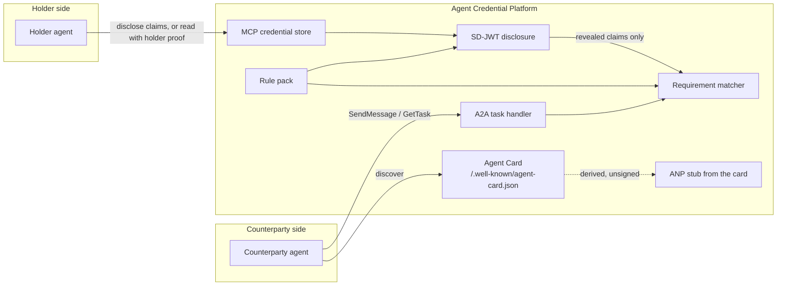

# Architecture

The platform is a thin coordination layer. It does not run a model, and it
does not implement a production credential stack. Three protocol adapters sit
in front of two pieces of domain logic: selective disclosure and matching.
Neither piece is tied to an industry.

## Roles

* **Issuer** signs a credential. On the wire that is `VerifiableCredential.issuer`, a DID.
* **Holder** is the credential subject. The holder chooses which claims to reveal.
* **Verifier** checks an SD-JWT against the issuers the rule pack trusts for that credential type (`src/acp/credentials/disclosure.py`).
* **Candidate** is a holder reduced to revealed claims (`src/acp/matching/profiles.py`).
* **Opportunity** is the counterparty's ask: a list of claim requirements. The matcher drops a candidate when a required check fails and scores the rest by weight.

A market is a rule pack (`src/acp/rules/pack.py`): accepted credential types, trusted issuers per type, required and weighted requirements, and a disclosure retention period. It does not get its own matcher.

## What talks to what

* **MCP** is the private-context channel. A holder's agent lists credentials and asks for a disclosure. `read_credential` returns the full credential only when `holder_proof` matches the holder, and is denied when that proof is missing. Counterparties use `disclose_claims`. See `src/acp/protocols/mcp/`.
* **A2A** is the collaboration channel. There is one matching agent. Its Agent Card is the source of truth, and it accepts tasks stamped with `tenantId` and `rulePackId`. Counterparties do not get a handle to the credential store. See `src/acp/protocols/a2a/`.
* **ANP / DIDs** stay available as a stub. `ANPAdapter` emits an unsigned Agent Description derived from the card. The resolver interface covers `did:key` (decoded offline), `did:web`, and `did:wba` (URL only, unless a document was cached). See `src/acp/protocols/anp/` and `src/acp/credentials/did.py`.
* **Credentials** are pydantic VC-shaped documents plus SD-JWT selective disclosure. BBS+ and zk-SNARK predicates implement the same scheme interface and refuse to run. See `src/acp/credentials/`.
* **Matching** applies the claim requirements from a rule pack. See `src/acp/matching/`.

## Flow

1. An issuer writes a credential into the holder's store. The record carries `tenant_id`, the rule-pack id, and that pack's retention period.
2. The holder's agent builds an SD-JWT of the claims the counterparty is allowed to see. A verifier checks the signature and the issuers that pack trusts for the credential type.
3. The market maps those revealed claims onto a `Candidate`.
4. The counterparty's `Opportunity` is loaded from the rule pack. The matcher applies it.
5. The outcome is recorded as an A2A task on the one matching agent. Withheld claims are not copied into that artifact. A disclosure record is kept until the pack's retention period elapses.

The HTTP app (`src/acp/app.py`) serves the card and the task endpoint. The MCP server is a separate process (`acp mcp`) because MCP hosts launch servers themselves, usually over stdio. They share code, not a live object, in this scaffold.

## Education rule pack

`src/acp/verticals/education.rules.json`, `education.py`, and `examples/school_match_demo.py` are the first pack, not the core. A state board and a school are the trusted issuers, configured in the JSON per credential type. Teachers and students are holders. North High is the counterparty. The module derives `grade_band` and `placement` from revealed claims, then calls `match_candidates`. `acp demo` runs that pack. The MCP server's default store is seeded with the same sample; another market is another JSON file and, if it needs derived claims, a small module.

## Processes

| Command | Process | Speaks |
| --- | --- | --- |
| `acp serve` | FastAPI via uvicorn | A2A Agent Card and JSON-RPC tasks |
| `acp mcp` | MCP server | Credential store tools |
| `acp demo` | One-shot script | Education example; no sockets |

Decisions recorded on Nov 2, 2026, and the choices still open, are in
[open-questions.md](open-questions.md). Remaining choices are marked in code
with `# OPEN QUESTION:`.
